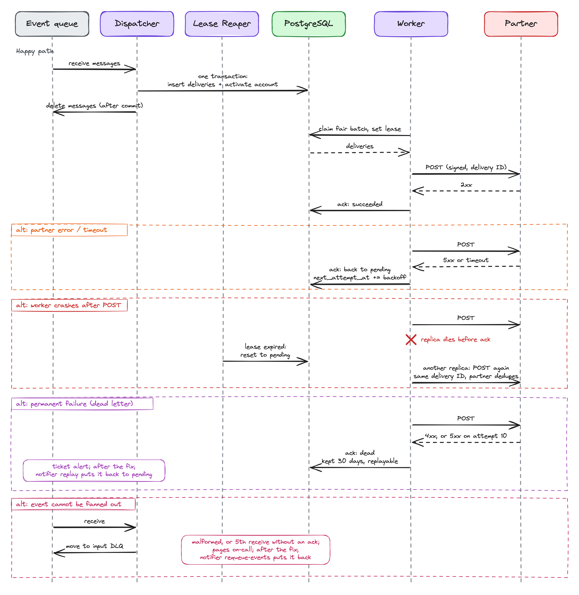
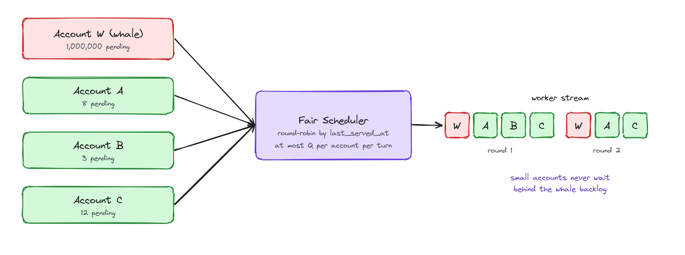

# Webhook Notifier: System Design

Author: Thinh Nguyen

Stack: Go, PostgreSQL.

# Context

Integration partners (third-party automation and CRM tools) register webhooks on a customer account through the existing webhook API. The Webhook Notifier is the missing piece: it listens to subscriber events, finds the webhooks that care about each one and POSTs the JSON payload to their post_url. Sending the request is easy; the hard parts are:

- Reliability: when our own system fails or a partner has network problems, the delivery should be retried later instead of being dropped.

- Scalability: the delivery workers need to scale horizontally with event volume and traffic, with no single component becoming a coordination bottleneck.

- Fairness: accounts range from a few hundred to hundreds of thousands of subscribers. A burst of subscriber.created events from a whale account must not delay deliveries for small accounts.

# Clarify scopes

Before starting, I went through a few open questions with the team. Here is what we agreed on:

1.  Event source: can be mocked. A fake producer sits behind an EventSource interface, so the production source plugs in later. In the PoC the mock is an events_queue table with a visibility timeout (received events reappear unless acked, like a managed queue); the producer process publishes to it and dispatchers on every replica consume from it with SKIP LOCKED.

2.  Delivery semantics: at-least-once, no ordering. Each request carries a delivery ID so receivers can drop duplicates.

3.  Scale: peak around 1,000 events/s; accounts range from thousands to millions of subscribers. Other numbers are my assumptions.

4.  Not specified, so assumed: a retry window of about 24h and HMAC-SHA256 payload signing.

Events in scope: subscriber.created, subscriber.unsubscribed, subscriber.added_to_segment. A 2xx response counts as delivered.

# Functional requirements

1.  Consume subscriber events and fan each one out to the account's active webhooks that subscribe to its type.

2.  POST the signed JSON payload to post_url with a delivery ID header; any 2xx is success.

3.  Retry temporary failures with backoff and jitter; after the retry window, mark the delivery dead and allow manual replay.

4.  Share capacity fairly between accounts.

5.  Expose metrics, and ship a test and benchmark setup (fake producer, fake partner, load scenarios).

# Out of scope

1.  The webhook management API and its auth (already exists; the PoC seeds a webhooks table).

2.  The real event pipeline in the subscriber service (mocked).

3.  Exactly-once delivery and ordering (confirmed not needed).

4.  Delivery-log UI, payload transformation, and production infrastructure manifests.

# Non-functional requirements

1.  Durability: once an event is received, its deliveries are never lost, even across crashes. At-least-once.

2.  Scalability: throughput grows by adding stateless worker replicas.

3.  Fairness: a small account's wait does not depend on other accounts' backlog; a whale uses the capacity small accounts leave free (in the benchmark it finished about 18% later than with a shared queue, because only one replica at a time can claim an account).

4.  Latency: event to first attempt P99 \< 5s for small and medium accounts, even during a whale burst, and P50 \< 1s under normal load. Partner response time is excluded, and a whale in its own burst is measured by throughput instead. Measured in the PoC: 4.2s p99 for small accounts during a 50k-event whale burst; at the full 1M burst the first-in-first-out input queue, not the scheduler, becomes the limit (bottlenecks.md, item 7).

5.  Isolation: a slow or broken partner cannot tie up all workers; we never flood a partner and respect Retry-After.

6.  Security: HTTPS only, SSRF protection, signed payloads.

7.  Observability: SLOs for freshness, reliability and durability, with error budgets and burn-rate alerts, and signals that show whether a problem is on our side or the partner side.

# Scale requirements

| **Parameter**               | **Value**                                               | **Source** |
|-----------------------------|---------------------------------------------------------|------------|
| Peak event rate             | 1,000 events/s                                          | Given      |
| Account size                | Thousands to millions of subscribers                    | Given      |
| Matching webhooks per event | About 1.5, so ~1,500 deliveries/s; designed for 2,000/s | Assumed    |
| Whale burst                 | 1M subscriber.created events within minutes             | Assumed    |
| Partner latency             | p50 200ms, p99 2s, timeout 10s                          | Assumed    |
| Retry window / retention    | ~24h over 10 attempts / 7 days (dead: 30 days)          | Assumed    |

### Back-of-the-envelope estimation

1.  Concurrency: with 2,000 deliveries/s (1,000 events/s × 1.5 webhooks, plus headroom) and a partner p50 of 200ms, Little's law gives about 400 requests in flight. If partners slow down to 2s, that becomes 4,000. This is why each endpoint gets its own concurrency limit.

2.  Database: about 3 row writes per delivery, so ~6,000 writes/s at peak. Fine for one PostgreSQL primary: claims are batched (one pass leases many deliveries); acks are one statement per delivery in the PoC, and batching them is the next step if writes become the limit.

3.  Storage: assuming average traffic is ~10% of the peak rate (~150 of the 1,500 deliveries/s), that is ~13M deliveries/day. At ~1.2 to 1.5 KB per delivery (row plus indexes), that is 15 to 20 GB a day, kept in daily partitions.

4.  Cost of a whale without fairness: 1M events at 1,000/s is roughly 17 minutes of backlog. If all accounts share one queue without per-account isolation, small accounts end up stuck in that backlog, whatever order the queue uses.

# High-level design

*Figure 1. Component overview*

1.  The subscriber service publishes events into an event queue owned by the notifier (mocked in the PoC).

2.  The Dispatcher pulls events from the queue.

3.  In one transaction it looks up the account's webhooks, inserts one deliveries row per match and marks the account active. Events are acked on the queue only after the commit.

4.  The Fair Scheduler claims a few due deliveries from each of the least recently served accounts and gives them a lease.

5.  Claimed deliveries go to the worker pool in the same process.

6.  Workers POST the signed payload to the partner.

7.  Workers record the result: succeeded, retry later, or dead.

8.  The Lease Reaper returns deliveries with an expired lease (crashed worker) to pending.

9.  Events that are malformed, or received 5 times without an ack, go to the input DLQ. It pages on-call, and notifier requeue-events puts them back after the fix.

10. Deliveries that fail for good (a permanent 4xx, or 10 failed attempts) become dead letters: kept 30 days, a ticket alert, and notifier replay puts them back to pending.

*Figure 2. Delivery sequence with retry, crash recovery and dead letters*

### Key design decisions

| **Decision**             | **Choice**                                                                                    | **Why**                                                                                                                                                                                                                         |
|--------------------------|-----------------------------------------------------------------------------------------------|---------------------------------------------------------------------------------------------------------------------------------------------------------------------------------------------------------------------------------|
| Where pending work lives | A deliveries table in PostgreSQL                                                              | Each delivery has its own state and retry time (next_attempt_at), we can pick work per account in any order, and fan-out is transactional. A partitioned log cannot reorder work per account and has no built-in delayed retry. |
| Fairness                 | Round-robin over active accounts, ordered by last_served_at, with a fixed batch size per turn | Simple, keeps all capacity busy, and only needs one small row per active account. The size of one account's backlog does not matter to the others.                                                                              |
| Scaling                  | Stateless replicas, each running a scheduler loop and a worker pool                           | No leader and no coordination besides row locks. More replicas means more throughput.                                                                                                                                           |
| Crash safety             | Leases (lease_until) plus a reaper                                                            | If a replica dies mid-request the delivery is retried instead of lost. This is also why delivery is at-least-once.                                                                                                              |
| Duplicates               | X-Webhook-Id header set to the delivery ID                                                    | Lets partners safely ignore repeats.                                                                                                                                                                                            |

# Detailed design

## 1. Data model

| **Table**      | **Columns and types**                                                                                                                                     | **Primary key**  | **Notes**                                                                                                         |
|----------------|-------------------------------------------------------------------------------------------------------------------------------------------------|------------------|-------------------------------------------------------------------------------------------------------------------|
| webhooks       | id uuid, account_id text, post_url text, events text\[\], secret text, status text, created_at timestamptz, updated_at timestamptz | id               | Owned by the existing API; read-only for us.                                                                      |
| deliveries     | id uuid, event_time timestamptz, account_id text, webhook_id uuid, event_id text, event_name text, payload jsonb, status text, attempts integer, next_attempt_at timestamptz, lease_until timestamptz, last_error text, delivered_at timestamptz, created_at timestamptz, trace_context text, replayed_at timestamptz | (id, event_time) | Daily partitions on event_time. id is a deterministic UUID of (event_id, webhook_id): dedup key and X-Webhook-Id. |
| account_queues | account_id text, active boolean, last_served_at timestamptz, next_due_at timestamptz | account_id       | Fairness state, one row per account.                                                                              |
| events_queue | id text, name text, account_id text, event_time timestamptz, payload jsonb, trace_context text, enqueued_at timestamptz, visible_at timestamptz, receive_count integer | id | Mock of the platform's event queue: a received event stays invisible until visible_at; ack = delete. |
| events_dead_letters | id text, name text, account_id text, event_time timestamptz, payload jsonb, trace_context text, receive_count integer, reason text, dead_at timestamptz | id | Input dead-letter queue: malformed events, or events received 5 times without an ack. |
| deliveries_dead_archive | same columns and types as deliveries | (id, event_time) | Dead rows of dropped partitions, kept 30 days and replayable. |

| **Index**                                                       | **Used by**                       |
|-----------------------------------------------------------------|-----------------------------------|
| webhooks (account_id) WHERE status = active                     | Dispatcher webhook lookup         |
| deliveries (account_id, next_attempt_at) WHERE status = pending | Scheduler claim                   |
| deliveries (lease_until) WHERE status = in_flight               | Lease Reaper                      |
| deliveries (account_id, event_time) WHERE status = dead         | Dead-letter inspection and replay |
| account_queues (last_served_at) WHERE active                    | Scheduler account pick            |
| deliveries (next_attempt_at) WHERE status = pending | Shared-queue claim (benchmark baseline only) |
| events_queue (visible_at), events_queue (enqueued_at) | Event receive; input queue age gauge |
| events_dead_letters (dead_at) | Input dead-letter age gauge |
| deliveries_dead_archive (account_id, event_time) | Dead-letter inspection and replay after retention |

- Partial indexes only hold pending, in-flight or dead rows, so they stay small however large the table grows.

- Partitioning by event_time (from the event, not insert time) keeps a redelivered event in the same partition, so the primary key still deduplicates. Old partitions are dropped, not deleted row by row. In the PoC the reaper role applies retention hourly: a daily partition is dropped 7 days after its day ends, after copying its dead rows into deliveries_dead_archive, where they are kept 30 days (and counted in the dead-letter gauge). A partition still holding pending or in-flight rows is skipped and logged, never dropped. Replaying an archived delivery recreates its partition and moves it back as pending.

- Daily partitions (UTC) are created on demand before an insert touches a new day, under an advisory lock so replicas do not race on the DDL. There is no default partition: rows in it would block creating that day's real partition later.

- attempts is incremented on every claim and doubles as the lease fencing token: acks are keyed by (id, event_time, attempts) and only apply while the row is still in_flight with that attempt. A worker whose lease was reaped (and maybe re-claimed by another worker) gets a "stale lease" result and drops its outcome. Acks always carry event_time, so they touch a single partition.

*Figure 3. Delivery states*

*Figure 3. Delivery states*

## 2. Fan-out (Dispatcher)

- Reads events in batches; webhook config comes from a per-account in-memory cache with a 30s TTL.

- One multi-row INSERT ... ON CONFLICT (id, event_time) DO NOTHING per batch, so a re-received event creates no duplicates. Accounts are activated with an upsert that only writes when the row was inactive, or when the new work is due before the account's current next_due_at (otherwise a new event would wait behind a retry scheduled hours later). A whale that already has due work is not rewritten, so it does not create a hot row. Only accounts that actually got new rows are touched, so a redelivered event changes nothing.

- Events are acked only after the commit. A crash before that means redelivery, absorbed by the primary key. Events that keep failing go to the queue's dead-letter queue.

- In the PoC: malformed events (missing account, event name or time, or a payload that is not a JSON object) are dead-lettered on sight with a reason, so one bad event cannot fail its whole batch forever. Events received EVENT_MAX_RECEIVES times (default 5) without an ack are moved to the dead-letter queue by the queue itself. As a second guard, fan-out refuses a batch whose event times span more than 62 days instead of creating a partition for every day in between (a zero event time once meant 740,000 partitions).

## 3. Fair scheduling

*Figure 4. Round-robin across accounts*

*Figure 4. Round-robin across accounts*

Round-robin with a quantum. Active accounts form a virtual ring ordered by when they were last served. Each turn the scheduler picks up to K accounts from the front of the ring (e.g. 50), takes at most Q due deliveries from each (the quantum, e.g. 10), leases them to workers, and moves those accounts to the back. Accounts with no work left leave the ring.

A whale with a million pending deliveries gets the same share per round as an account with three, so its backlog only affects how many rounds it needs. When nobody else has work, the whale gets the full capacity. To make that true, the quantum is a floor, not a cap, when every due account fits in one pass: an account may then take up to the free slots minus the other picked accounts, and the interleaved ordering still gives every other account its due work first. When more accounts wait than fit in a pass, the quantum holds. (The first benchmark run showed a strict quantum left a lone whale using a fraction of the workers: 51.7s vs 34.3s with a shared queue. With the floor it is 48.9s vs 41.5s; the remaining gap comes from only one replica at a time holding the whale's account row.) One pass of the claim loop is a single short transaction:

> **WITH** picked **AS** (
>
> **SELECT** account_id **FROM** account_queues
>
> **WHERE** active **AND** next_due_at \<= now()
>
> **ORDER** **BY** last_served_at
>
> **LIMIT** \$accounts_per_tick *-- e.g. 50*
>
> **FOR** **UPDATE** **SKIP** **LOCKED**
>
> ), claimed **AS** (
>
> **SELECT** d.id **FROM** picked p
>
> **CROSS** **JOIN** **LATERAL** (
>
> **SELECT** id **FROM** deliveries
>
> **WHERE** account_id = p.account_id
>
> **AND** status = 'pending' **AND** next_attempt_at \<= now()
>
> **ORDER** **BY** next_attempt_at
>
> **LIMIT** \$quantum *-- e.g. 10*
>
> **FOR** **UPDATE** **SKIP** **LOCKED**
>
> ) d
>
> )
>
> **UPDATE** deliveries
>
> **SET** status = 'in_flight', attempts = attempts + 1,
>
> lease_until = now() + **interval** '30 seconds'
>
> **WHERE** id **IN** (**SELECT** id **FROM** claimed)
>
> **RETURNING** \*;
>
> *-- then: UPDATE account_queues SET last_served_at = now(),*
>
> *-- next_due_at = \<min next_attempt_at of remaining pending rows\>,*
>
> *-- active = \<remaining pending rows exist\> WHERE account_id IN (picked)*

- SKIP LOCKED lets many replicas claim in parallel without a leader, and locking the account rows stops two replicas from serving the same account in one round.

- A replica only claims as many deliveries as it has free worker slots. It picks at most that many accounts, and when the slots are fewer than K × Q the claimed rows are interleaved (ordered by position within the account, then position in the ring) so every account gets its first delivery before any gets a second. Only accounts that received rows move to the back of the ring; the others keep their place.

- In the implementation the pass is three statements in one transaction: lock the accounts, lease the deliveries (the LATERAL query above), then recompute next_due_at and active for the picked accounts.

- Keeping the account ring consistent. The claim takes an account out of the ring when it leases its last pending row, while that row is still in flight. So every path that makes a row pending again activates the account in the same transaction: fan-out, a retry ack, the reaper and dead-letter replay. Each of them changes deliveries first and upserts account_queues second. If a claim holds the account row, the upsert waits for it and then re-checks against the claim's committed result (possibly active = false), so the reactivation is not lost. If the upsert holds the row, the claim skips that account for one pass. The claim never waits on a lock (SKIP LOCKED), and writers upsert accounts in account_id order, so there is no deadlock cycle. An integration test races fan-out against concurrent claimers to check this.

- It extends naturally to weighted fairness: a weight column on account_queues (e.g. 1 for free, 2 for paid) and a quantum of base × weight. A premium whale still only gets its weighted share, so small accounts stay protected.

| **Alternative**                               | **Verdict**                                                                                                                                                                                                                                                                                                                                                                 |
|-----------------------------------------------|-----------------------------------------------------------------------------------------------------------------------------------------------------------------------------------------------------------------------------------------------------------------------------------------------------------------------------------------------------------------------------|
| One shared queue for all accounts             | No: a whale burst fills it and small accounts wait behind it.                                                                                                                                                                                                                                                                                                               |
| A partitioned log keyed by account_id         | No: hash collisions put whales next to small accounts, and there is no delayed retry.                                                                                                                                                                                                                                                                                       |
| A managed cloud queue with per-tenant fair queues (message group = account_id) | Viable build-vs-buy option: the managed queue serves quieter tenants first, with no scheduler code. Trade-offs: the fairness policy is a black box (no quantum or plan weights), delayed retries are limited (short maximum delay and visibility timeout), and delivery state cannot be queried or selectively replayed without a separate table. I build the scheduler to keep control of these. |

The shared queue is kept as a benchmark baseline (CLAIM_MODE=shared): it leases the oldest due deliveries across all accounts, with its own index on next_attempt_at so it is not slowed down by sorting the backlog. It is not meant for production.

## 4. Delivery, retries and failure handling

- HTTP client with connection pooling, 10s timeout, no redirects. Headers: X-Webhook-Id, X-Webhook-Timestamp, X-Webhook-Signature (HMAC-SHA256 of timestamp and body).

| **Response**                             | **Action**                                          |
|------------------------------------------|-----------------------------------------------------|
| 2xx                                      | Succeeded                                           |
| 408, 429, 5xx, timeout, connection error | Back to pending with backoff; Retry-After respected |
| 410 Gone                                 | Dead, and the webhook is disabled                   |
| Other 4xx, or attempts exhausted         | Dead, replayable with `notifier replay` (kept 30 days) |
| 3xx (redirects are not followed)         | Dead: the registered URL is misconfigured, and following it would send the signed payload elsewhere |
| Webhook disabled or deleted              | Dead without a request                              |

- Backoff starts at 30s and triples after each failure, capped at 8h, with at most 10 attempts (about 24h). Each delay gets ±20% jitter so retries after an outage do not hit the partner as one spike. All values are configuration. A Retry-After header (seconds or HTTP date) wins when it asks for a longer wait than the backoff, capped at the 8h maximum; a shorter one is ignored, since waiting longer still respects it.

- The claim returns each delivery with its webhook URL, secret and status, so workers need no extra lookup and see a disabled webhook immediately.

- A worker whose lease was lost (the reaper reset the delivery while the request was in flight) has its ack rejected by the fencing check; the result is logged and dropped, since the delivery is already scheduled again.

- On SIGTERM a replica stops claiming and waits for in-flight requests, which run on a context shutdown does not cancel and are bounded by the HTTP timeout. The container stop grace period (15s) is longer than that timeout.

- Leases last 30s, longer than the HTTP timeout. The reaper resets expired leases every 10s, so a crashed worker's deliveries are sent again. The crashed attempt counts, so a delivery whose lease expires on its last allowed attempt goes to dead instead of pending. Each pass resets expired leases in batches (1,000 per statement) until none are left, so a crash that orphaned many leases is recovered in one pass while every statement stays short.

- Dead-letter replay: `notifier replay --account=… --webhook=… --from=… --to=…` (or `make replay ARGS=…`) returns matching dead deliveries to pending with a fresh attempt budget and puts their accounts back in the ring. Replays go through the fair scheduler like any other work. An empty filter is refused unless `--all` is given, so an admin cannot flood every partner by accident.

- Per-endpoint concurrency limit and circuit breaker: a slow partner holds only a few workers, and while the circuit is open deliveries are postponed without using up attempts. A retry budget (~20% of attempts) keeps failing partners from crowding out fresh traffic.

  - The limit (8 concurrent requests per host:port, per replica) never blocks: a worker that cannot get a slot postpones the delivery by 1s and moves on, so a slow partner cannot tie up the pool.
  - The breaker opens after 5 consecutive partner-side failures (5xx, 408, 429, timeouts, connection errors; a 4xx means the partner is up). While open, deliveries are postponed until the cooldown (30s) ends. Then a single probe is let through: success closes the circuit, failure opens it for another cooldown. The limit is checked before the breaker, so a probe is never postponed and lost.
  - Postponing refunds the attempt the claim counted, so an outage on the partner side does not push deliveries towards dead.
  - Limits and circuits are per replica (in memory). With N replicas a host sees at most N × 8 concurrent requests; a shared limit would need coordination and is not worth it at this scale.
  - Not implemented yet: the retry budget.

- SSRF guard: the dialer refuses private, loopback and link-local addresses.

  - The check runs on the IP actually dialled, after DNS resolution, so a hostname that resolves (or re-resolves) to an internal address is caught. Also refused: unspecified, multicast, carrier-grade NAT (100.64.0.0/10) and IPv4-mapped forms of all of these. Plain http:// and non-HTTP schemes are refused too, and environment proxies are ignored.
  - A refused target is dead, not retried: retrying cannot make the URL acceptable.
  - Local development only: ALLOW_HTTP and ALLOW_PRIVATE_NETWORKS relax both checks so the fake partner on the compose network works; the notifier logs a warning when either is set.

## 5. Observability and monitoring

The approach: measure what users feel, set SLOs on it, alert on how fast the error budget burns, and treat partner problems separately from our own. Every latency is measured from the event time of the original event, so time spent waiting in the queue is always included.

### Four golden signals

| **Signal** | **What we measure**                                                                                                                                                       |
|------------|---------------------------------------------------------------------------------------------------------------------------------------------------------------------------|
| Latency    | Time from event to first attempt, by account tier. Partner HTTP duration, with successful and failed requests measured separately so timeouts do not distort the numbers. |
| Traffic    | Events consumed per second, deliveries attempted per second, number of active accounts.                                                                                   |
| Errors     | Our own errors (DB errors, failed fan-out, malformed events) kept apart from partner errors (5xx, timeouts, 4xx). Only our errors count against the reliability SLO.                |
| Saturation | Worker slots in use, DB connection pool usage, per-endpoint semaphores at their limit, pending backlog and the age of the oldest due delivery.                            |

### SLIs and SLOs

Each SLI is a ratio of good events to valid events over a rolling 28-day window. Accounts are grouped into tiers by list size so fairness can be measured without one label per account.

| **SLI (good / valid)**                                                                                                                     | **SLO**                  |
|--------------------------------------------------------------------------------------------------------------------------------------------|--------------------------|
| Freshness, small tier (the PoC has two tiers, small and large): deliveries whose first attempt happens within 5s of the event / all small-tier deliveries | 99%                      |
| Freshness, all tiers in normal load: first attempt within 1s / all deliveries (measured by the histogram, not alerted in the PoC)           | 50% (the p50 target)     |
| Reliability: deliveries that succeed, or fail only because of the partner (4xx, endpoint down for the whole retry window) / all deliveries (not measured in the PoC: it needs failures caused by us counted per delivery) | 99.99%                   |
| Durability: events consumed that produced their deliveries / events consumed (a periodic reconciliation job would check this; it is not built. In the PoC an event that reaches the input dead-letter queue is a durability miss and pages)                    | 100%, any miss is a page |

Large accounts are expected to queue behind their own bursts, so they are measured by throughput instead of latency: while a whale has a backlog, it should get all capacity that small accounts are not using.

### Error budget

- A 99% freshness SLO leaves a budget of 1% late deliveries. At the assumed average of about 13M deliveries a day, that is roughly 3.6M late deliveries per 28 days.

- While budget is left, the team can ship changes to the scheduler and workers freely. When it runs out, feature work on the notifier pauses and the next changes focus on reliability, until the budget recovers.

- A burn caused by the whale scenario is the signal that fairness tuning (quantum, accounts per tick, per-account caps) needs attention.

### Metrics

| **Metric**                                                   | **Type**       | **Purpose**                                             |
|--------------------------------------------------------------|----------------|---------------------------------------------------------|
| webhook_first_attempt_latency_seconds{tier}                  | Histogram      | Freshness SLI and fairness                              |
| webhook_end_to_end_seconds{outcome}                          | Histogram      | Time from event to succeeded or dead                    |
| webhook_http_duration_seconds{result}                        | Histogram      | Partner latency, split by success and failure           |
| webhook_deliveries_total{outcome, cause}                     | Counter        | Traffic, and errors split into our side vs partner side |
| webhook_pending_deliveries, webhook_active_accounts          | Gauge          | Backlog and how many accounts are waiting               |
| webhook_dead_deliveries                                      | Gauge          | Dead-letter queue size (dead, not replayed)             |
| webhook_oldest_due_pending_age_seconds                       | Gauge          | Saturation of the whole pipeline                        |
| webhook_worker_slots_in_use, db_pool_in_use                  | Gauge          | Saturation of a replica                                 |
| webhook_endpoint_throttled_total, webhook_circuit_open{host} | Counter, Gauge | Partner health and per-endpoint limits being hit        |
| webhook_input_events_waiting, webhook_input_oldest_event_age_seconds | Gauge          | Ingest falling behind                                   |
| webhook_input_dead_letters, webhook_input_dead_letter_oldest_age_seconds | Gauge          | Events the Dispatcher could not fan out after N receives (malformed or failing repeatedly) |
| webhook_events_consumed_total, webhook_errors_total{component} | Counter      | Ingest rate; our own errors (fanout, claim, reaper, retention, event_source, webhook_lookup, malformed_event, metrics), kept apart from partner errors |

Implementation notes (PoC):

- Metrics are recorded with OpenTelemetry and exposed by its Prometheus exporter on /metrics of each replica (no collector). `make up-metrics` adds a Prometheus that scrapes both replicas.
- webhook_deliveries_total causes: http_2xx, http_3xx, http_4xx, http_410, http_429, http_5xx, timeout, connection, blocked, circuit_open, throttled, webhook_disabled. Outcomes: succeeded, retry, dead, gone, postponed.
- Tiers: the notifier does not know list sizes, so the tier label comes from configuration (LARGE_ACCOUNTS → "large", every other account → "small"). Enough for the whale-vs-small benchmark; production would read the tier from account data.
- The backlog gauges come from one query per scrape per replica, using the partial indexes. webhook_circuit_open and webhook_worker_slots_in_use are per replica.
- A replayed delivery restarts at attempt 1 but carries replayed_at, so its attempt is not counted in first-attempt latency (it would otherwise report an old event time as a freshness miss).
- Input queue gauges: webhook_input_events_waiting and webhook_input_oldest_event_age_seconds, read from the mock queue.

### Logs and tracing

- One structured log line per attempt with delivery_id, account_id, webhook_id, attempt, status code, duration and error. Per-account questions are answered here, since account IDs are too many for metric labels.

- Trace context is carried from the event through fan-out, claim and the HTTP call, so a slow delivery can be split into time waiting in the queue and time spent at the partner.

- In the PoC (OpenTelemetry, OTLP/HTTP to a local trace viewer with `make up-metrics`, UI on :16686): the event carries a W3C traceparent (the producer's `subscriber.event` span); the dispatcher starts one `webhook.fanout` span per event as its child and stores that context on each delivery row; every attempt is a `webhook.deliver` span (delivery, account, webhook, attempt, outcome, cause, and `webhook.queue_wait_ms` from event to send) with an `HTTP POST` client child span. The traceparent is also sent to partners. Root spans are sampled at OTEL_TRACES_SAMPLER_ARG and everything else follows its parent, so a trace is kept or dropped end to end. Claim passes are not traced per delivery: one claim leases many deliveries, and queue wait already covers the time spent waiting.

### Alerting

Alerts fire on SLO burn rate rather than fixed thresholds, using a long and a short window so they trigger fast on real incidents and stop quickly once the issue is fixed.

| **Budget burned** | **Burn rate** | **Windows (long and short)** | **Action** |
|-------------------|---------------|------------------------------|------------|
| 2% in 1 hour      | 14.4x         | 1h and 5min                  | Page       |
| 5% in 6 hours     | 6x            | 6h and 30min                 | Page       |
| 10% in 3 days     | 1x            | 3d and 6h                    | Ticket     |

- Durability misses page: in the PoC, WebhookInputDeadLetters pages as soon as the input dead-letter queue is not empty (deploy/alerts.yml, runbook: docs/runbook.md#input-dead-letters). An alert on a growing input queue age is not written yet; webhook_input_oldest_event_age_seconds is exported for it.

- Errors from a single partner endpoint never page. They open that endpoint's circuit breaker and are visible in webhook_deliveries_total by cause and in webhook_circuit_open{host}. A partner dashboard and a daily report are not built in the PoC.

- Dead letters are tickets, never pages: more than 1% of attempts ending dead over 30m (postponed attempts excluded so a circuit cannot hide them), a dead-letter queue above 10,000, or one that grew by more than 1,000 in an hour. Runbook: docs/runbook.md#dead-letters.

- In the PoC: deploy/alerts.yml holds the dead-letter rules (delivery dead letters as tickets, input dead letters as a page), unit-tested with promtool (`make test-alerts`, part of `make test`) and loaded by the compose Prometheus. The freshness SLO burn-rate alerts above are implemented as recording rules (error ratio over 5m, 30m, 1h, 6h, 3d from the first-attempt histogram, small tier, le="5") and the three multi-window alerts, all promtool-tested, including that a page stops once the short window recovers. Alertmanager routes pages and tickets to separate receivers (no integrations in the PoC) and inhibits an SLO's ticket while its page fires; `make test-alerts` checks the routing with amtool. Not alerted yet: the 1s p50 freshness objective, and the reliability SLO, which needs "failed because of us" counted per delivery.

- Every alert links to docs/runbook.md, which covers dead letters, input dead letters and freshness: how to tell our fault from a partner's, how to check fairness by tier, how to find the affected accounts, and how to replay dead deliveries (make replay) or requeue dead events (make requeue-events). Pausing or throttling a single account is not built.

### Dashboards

Not built in the PoC; these are the intended views. The same signals are available as Prometheus queries on `make up-metrics` (see the README).

- SLO overview: remaining error budget and current burn rate for each SLI.

- Golden signals: latency by tier next to traffic and backlog. During a whale burst the small tier line should stay flat.

- Partners: top endpoints by error rate and latency, open circuits, throttling.

- Database: claim query duration, rows claimed per tick, lock waits and table bloat.

## 6. PoC, tests and benchmarks

Go and PostgreSQL. make up starts the database, notifier replicas, a fake producer and a fake partner with configurable latency, errors and outages. make test runs unit and integration tests; make bench runs:

| **Scenario**                                                                                                                       | **What it shows**         | **Expected result**                                                       |
|------------------------------------------------------------------------------------------------------------------------------------|---------------------------|---------------------------------------------------------------------------|
| Whale burst: 1 account with 1M events plus 1,000 accounts with 10 events each, run with a shared queue and with the fair scheduler | Fairness                  | Small-account p99 goes from minutes (shared queue) to under 5s (fair)     |
| 1,000 events/s for 10 minutes with 1, 2 and 4 replicas                                                                             | Horizontal scaling        | Throughput grows close to linearly until the database becomes the limit   |
| Partner returns 5% errors and one endpoint is down for 5 minutes                                                                   | Reliability and isolation | Every delivery eventually succeeds and healthy endpoints are not affected |
| Kill a replica in the middle of a run                                                                                              | Crash safety              | No lost deliveries and a small, counted number of duplicates              |

How the PoC runs them (`make bench`, `BENCH_SCALE=quick|default|full`):

- Each scenario gets a throwaway database on the compose Postgres, the fake partner over real HTTP, and N in-process "replicas" (dispatcher, claim loop with workers, and reaper, each with its own connection pool). Running them in one process keeps runs repeatable; the database, the HTTP path and the SQL are the real ones.
- A crash closes a replica's connection pool and stops it mid-run: requests already sent still reach the partner but are never acked, which is exactly what produces at-least-once duplicates.
- Timings are compressed so runs take minutes: lease 3s, HTTP timeout 1s, reaper every 0.5s, backoff from 0.5s doubling to 5s, outage 15s instead of 5 minutes. `full` uses the design's sizes (1M whale events, 10-minute runs) and takes hours.
- Latency is measured by the partner: from the event time in the payload to the first request (first attempt) or the first 2xx (delivered).
- The whale-burst scenario raises the per-host limit so the single fake partner host is not the bottleneck: it isolates the scheduler. The outage scenario puts the failing endpoint on its own listener (its own host), since limits and circuits are per host.

Results (`make bench`, default scale, on a laptop; runs vary by about ±20%; the full design sizes, `BENCH_SCALE=full`, take hours and were not run):

| Scenario | Run | Result |
|---|---|---|
| Whale burst | 50k whale events + 500 small accounts × 10 events, 2 replicas × 32 workers | Small-account p99, event to first attempt: 34.3s shared queue → 4.2s fair. Whale's last delivery: 41.5s shared, 48.9s fair. |
| Horizontal scaling | 1,200 events/s offered for 10s, 16 workers per replica, partner latency 50ms | 239 / 443 / 846 deliveries/s with 1 / 2 / 4 replicas |
| Reliability and isolation | 300 events/s for 20s, 5% partner errors, one endpoint down for 15s | 5,997 / 5,997 delivered, 0 dead; healthy endpoints' first-attempt p99 244ms |
| Crash safety | 300 events/s for 20s, one of 2 replicas killed after 7s | 5,997 / 5,997 delivered, 0 lost, 3 duplicates |

Bottlenecks and how the design evolves at higher scale are covered in the separate Bottleneck discussion doc.
