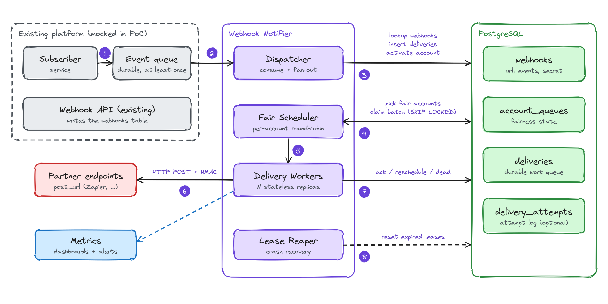
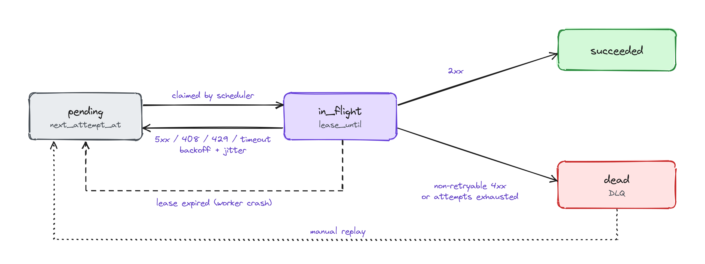

# Webhook Notifier: System Design

Author: Thinh Nguyen

Stack: Go, PostgreSQL.

# Context

Integration partners such as Zapier register webhooks on a customer account through the existing webhook API. The Webhook Notifier is the missing piece: it listens to subscriber events, finds the webhooks that care about each one and POSTs the JSON payload to their post_url. Sending the request is easy; the hard parts are:

- Reliability: when our own system fails or a partner has network problems, the delivery should be retried later instead of being dropped.

- Scalability: the delivery workers need to scale horizontally with event volume and traffic, with no single component becoming a coordination bottleneck.

- Fairness: accounts range from a few hundred to hundreds of thousands of subscribers. A burst of subscriber.created events from a whale account must not delay deliveries for small accounts.

# Clarify scopes

Before starting, I went through a few open questions with the team. Here is what we agreed on:

1.  Event source: can be mocked. A fake producer sits behind an EventSource interface, so the production source plugs in later.

2.  Delivery semantics: at-least-once, no ordering. Each request carries a delivery ID so receivers can drop duplicates.

3.  Scale: peak around 1,000 events/s; accounts range from thousands to millions of subscribers. Other numbers are my assumptions.

4.  Not specified, so assumed: a retry window of about 24h and HMAC-SHA256 payload signing.

Events in scope: subscriber.created, subscriber.unsubscribed, subscriber.added_to_segment. A 2xx response counts as delivered.

# Functional requirements

1.  Consume subscriber events and fan each one out to the account's active webhooks that subscribe to its type.

2.  POST the signed JSON payload to post_url with a delivery ID header; any 2xx is success.

3.  Retry temporary failures with backoff and jitter; after the retry window, mark the delivery dead and allow manual replay.

4.  Share capacity fairly between accounts.

5.  Expose metrics, and ship a test and benchmark setup (fake producer, fake partner, load scenarios).

# Out of scope

1.  The webhook management API and its auth (already exists; the PoC seeds a webhooks table).

2.  The real event pipeline in the subscriber service (mocked).

3.  Exactly-once delivery and ordering (confirmed not needed).

4.  Delivery-log UI, payload transformation, and production infrastructure manifests.

# Non-functional requirements

1.  Durability: once an event is received, its deliveries are never lost, even across crashes. At-least-once.

2.  Scalability: throughput grows by adding stateless worker replicas.

3.  Fairness: a small account's wait does not depend on other accounts' backlog; a whale still uses all spare capacity.

4.  Latency: event to first attempt P99 \< 5s for small and medium accounts, even during a whale burst, and P50 \< 1s under normal load. Partner response time is excluded, and a whale in its own burst is measured by throughput instead.

5.  Isolation: a slow or broken partner cannot tie up all workers; we never flood a partner and respect Retry-After.

6.  Security: HTTPS only, SSRF protection, signed payloads.

7.  Observability: SLOs for freshness, reliability and durability, with error budgets and burn-rate alerts, and signals that show whether a problem is on our side or the partner side.

# Scale requirements

| **Parameter**               | **Value**                                               | **Source** |
|-----------------------------|---------------------------------------------------------|------------|
| Peak event rate             | 1,000 events/s                                          | Given      |
| Account size                | Thousands to millions of subscribers                    | Given      |
| Matching webhooks per event | About 1.5, so ~1,500 deliveries/s; designed for 2,000/s | Assumed    |
| Whale burst                 | 1M subscriber.created events within minutes             | Assumed    |
| Partner latency             | p50 200ms, p99 2s, timeout 10s                          | Assumed    |
| Retry window / retention    | ~24h over 10 attempts / 7 days (dead: 30 days)          | Assumed    |

### Back-of-the-envelope estimation

1.  Concurrency: with 2,000 deliveries/s (1,000 events/s × 1.5 webhooks, plus headroom) and a partner p50 of 200ms, Little's law gives about 400 requests in flight. If partners slow down to 2s, that becomes 4,000. This is why each endpoint gets its own concurrency limit.

2.  Database: about 3 row writes per delivery, so ~6,000 writes/s at peak. Fine for one PostgreSQL primary with batched claims and acks.

3.  Storage: at ~10% of peak on average, ~13M deliveries/day (15 to 20 GB with indexes), kept in daily partitions.

4.  Cost of a whale without fairness: 1M events at 1,000/s is roughly 17 minutes of backlog. If all accounts share one queue without per-account isolation, small accounts end up stuck in that backlog, whatever order the queue uses.

# High-level design

*Figure 1. Component overview*

*Figure 1. Component overview*

1.  The subscriber service publishes events into an event queue owned by the notifier (mocked in the PoC).

2.  The Dispatcher pulls events from the queue.

3.  In one transaction it looks up the account's webhooks, inserts one deliveries row per match and marks the account active. Events are acked on the queue only after the commit.

4.  The Fair Scheduler claims a few due deliveries from each of the least recently served accounts and gives them a lease.

5.  Claimed deliveries go to the worker pool in the same process.

6.  Workers POST the signed payload to the partner.

7.  Workers record the result: succeeded, retry later, or dead.

8.  The Lease Reaper returns deliveries with an expired lease (crashed worker) to pending.

*Figure 2. Delivery sequence with retry and crash recovery*

*Figure 2. Delivery sequence with retry and crash recovery*

### Key design decisions

| **Decision**             | **Choice**                                                                                    | **Why**                                                                                                                                                                                                                         |
|--------------------------|-----------------------------------------------------------------------------------------------|---------------------------------------------------------------------------------------------------------------------------------------------------------------------------------------------------------------------------------|
| Where pending work lives | A deliveries table in PostgreSQL                                                              | Each delivery has its own state and retry time (next_attempt_at), we can pick work per account in any order, and fan-out is transactional. A partitioned log cannot reorder work per account and has no built-in delayed retry. |
| Fairness                 | Round-robin over active accounts, ordered by last_served_at, with a fixed batch size per turn | Simple, keeps all capacity busy, and only needs one small row per active account. The size of one account's backlog does not matter to the others.                                                                              |
| Scaling                  | Stateless replicas, each running a scheduler loop and a worker pool                           | No leader and no coordination besides row locks. More replicas means more throughput.                                                                                                                                           |
| Crash safety             | Leases (lease_until) plus a reaper                                                            | If a replica dies mid-request the delivery is retried instead of lost. This is also why delivery is at-least-once.                                                                                                              |
| Duplicates               | X-Webhook-Id header set to the delivery ID                                                    | Lets partners safely ignore repeats.                                                                                                                                                                                            |

# Detailed design

## 1. Data model

| **Table**      | **Columns**                                                                                                                                     | **Primary key**  | **Notes**                                                                                                         |
|----------------|-------------------------------------------------------------------------------------------------------------------------------------------------|------------------|-------------------------------------------------------------------------------------------------------------------|
| webhooks       | id, account_id, post_url, events text\[\], secret, status                                                                                       | id               | Owned by the existing API; read-only for us.                                                                      |
| deliveries     | id, event_time, account_id, webhook_id, event_id, event_name, payload, status, attempts, next_attempt_at, lease_until, last_error, delivered_at | (id, event_time) | Daily partitions on event_time. id is a deterministic UUID of (event_id, webhook_id): dedup key and X-Webhook-Id. |
| account_queues | account_id, active, last_served_at, next_due_at                                                                                                 | account_id       | Fairness state, one row per account.                                                                              |

| **Index**                                                       | **Used by**                       |
|-----------------------------------------------------------------|-----------------------------------|
| webhooks (account_id) WHERE status = active                     | Dispatcher webhook lookup         |
| deliveries (account_id, next_attempt_at) WHERE status = pending | Scheduler claim                   |
| deliveries (lease_until) WHERE status = in_flight               | Lease Reaper                      |
| deliveries (account_id, event_time) WHERE status = dead         | Dead-letter inspection and replay |
| account_queues (last_served_at) WHERE active                    | Scheduler account pick            |

- Partial indexes only hold pending, in-flight or dead rows, so they stay small however large the table grows.

- Partitioning by event_time (from the event, not insert time) keeps a redelivered event in the same partition, so the primary key still deduplicates. Old partitions are dropped, not deleted row by row.

*Figure 3. Delivery states*

*Figure 3. Delivery states*

## 2. Fan-out (Dispatcher)

- Reads events in batches; webhook config comes from a per-account in-memory cache with a 30s TTL.

- One multi-row INSERT ... ON CONFLICT (id, event_time) DO NOTHING per batch, so a re-received event creates no duplicates. Accounts are activated with an upsert that only writes when the row was inactive, so whales do not create a hot row.

- Events are acked only after the commit. A crash before that means redelivery, absorbed by the primary key. Events that keep failing go to the queue's dead-letter queue.

## 3. Fair scheduling

*Figure 4. Round-robin across accounts*

*Figure 4. Round-robin across accounts*

Round-robin with a quantum. Active accounts form a virtual ring ordered by when they were last served. Each turn the scheduler picks up to K accounts from the front of the ring (e.g. 50), takes at most Q due deliveries from each (the quantum, e.g. 10), leases them to workers, and moves those accounts to the back. Accounts with no work left leave the ring.

A whale with a million pending deliveries gets the same share per round as an account with three, so its backlog only affects how many rounds it needs. When nobody else has work, the whale gets the full capacity. One pass of the claim loop is a single short transaction:

> **WITH** picked **AS** (
>
> **SELECT** account_id **FROM** account_queues
>
> **WHERE** active **AND** next_due_at \<= now()
>
> **ORDER** **BY** last_served_at
>
> **LIMIT** \$accounts_per_tick *-- e.g. 50*
>
> **FOR** **UPDATE** **SKIP** **LOCKED**
>
> ), claimed **AS** (
>
> **SELECT** d.id **FROM** picked p
>
> **CROSS** **JOIN** **LATERAL** (
>
> **SELECT** id **FROM** deliveries
>
> **WHERE** account_id = p.account_id
>
> **AND** status = 'pending' **AND** next_attempt_at \<= now()
>
> **ORDER** **BY** next_attempt_at
>
> **LIMIT** \$quantum *-- e.g. 10*
>
> **FOR** **UPDATE** **SKIP** **LOCKED**
>
> ) d
>
> )
>
> **UPDATE** deliveries
>
> **SET** status = 'in_flight', attempts = attempts + 1,
>
> lease_until = now() + **interval** '30 seconds'
>
> **WHERE** id **IN** (**SELECT** id **FROM** claimed)
>
> **RETURNING** \*;
>
> *-- then: UPDATE account_queues SET last_served_at = now(),*
>
> *-- next_due_at = \<min next_attempt_at of remaining pending rows\>,*
>
> *-- active = \<remaining pending rows exist\> WHERE account_id IN (picked)*

- SKIP LOCKED lets many replicas claim in parallel without a leader, and locking the account rows stops two replicas from serving the same account in one round.

- A replica only claims as many deliveries as it has free worker slots.

- It extends naturally to weighted fairness: a weight column on account_queues (e.g. 1 for free, 2 for paid) and a quantum of base × weight. A premium whale still only gets its weighted share, so small accounts stay protected.

| **Alternative**                               | **Verdict**                                                                                                                                                                                                                                                                                                                                                                 |
|-----------------------------------------------|-----------------------------------------------------------------------------------------------------------------------------------------------------------------------------------------------------------------------------------------------------------------------------------------------------------------------------------------------------------------------------|
| One shared queue for all accounts             | No: a whale burst fills it and small accounts wait behind it.                                                                                                                                                                                                                                                                                                               |
| A partitioned log keyed by account_id         | No: hash collisions put whales next to small accounts, and there is no delayed retry.                                                                                                                                                                                                                                                                                       |
| SQS fair queues (MessageGroupId = account_id) | Viable build-vs-buy option on AWS: SQS serves quieter tenants first, with no scheduler code. Trade-offs: the fairness policy is a black box (no quantum or plan weights), delayed retries are limited (15min delay, 12h visibility), and delivery state cannot be queried or selectively replayed without a separate table. I build the scheduler to keep control of these. |

## 4. Delivery, retries and failure handling

- HTTP client with connection pooling, 10s timeout, no redirects. Headers: X-Webhook-Id, X-Webhook-Timestamp, X-Webhook-Signature (HMAC-SHA256 of timestamp and body).

| **Response**                             | **Action**                                          |
|------------------------------------------|-----------------------------------------------------|
| 2xx                                      | Succeeded                                           |
| 408, 429, 5xx, timeout, connection error | Back to pending with backoff; Retry-After respected |
| 410 Gone                                 | Dead, and the webhook is disabled                   |
| Other 4xx, or attempts exhausted         | Dead, replayable by an admin command (kept 30 days) |

- Backoff starts at 30s and triples after each failure, capped at 8h, with at most 10 attempts (about 24h). Each delay gets ±20% jitter so retries after an outage do not hit the partner as one spike. All values are configuration.

- Leases last 30s, longer than the HTTP timeout. The reaper resets expired leases every 10s, so a crashed worker's deliveries are sent again.

- Per-endpoint concurrency limit and circuit breaker: a slow partner holds only a few workers, and while the circuit is open deliveries are postponed without using up attempts. A retry budget (~20% of attempts) keeps failing partners from crowding out fresh traffic.

- SSRF guard: the dialer refuses private, loopback and link-local addresses.

## 5. Observability and monitoring

The approach: measure what users feel, set SLOs on it, alert on how fast the error budget burns, and treat partner problems separately from our own. Every latency is measured from the event time of the original event, so time spent waiting in the queue is always included.

### Four golden signals

| **Signal** | **What we measure**                                                                                                                                                       |
|------------|---------------------------------------------------------------------------------------------------------------------------------------------------------------------------|
| Latency    | Time from event to first attempt, by account tier. Partner HTTP duration, with successful and failed requests measured separately so timeouts do not distort the numbers. |
| Traffic    | Events consumed per second, deliveries attempted per second, number of active accounts.                                                                                   |
| Errors     | Our own errors (DB errors, failed fan-out, panics) kept apart from partner errors (5xx, timeouts, 4xx). Only our errors count against the reliability SLO.                |
| Saturation | Worker slots in use, DB connection pool usage, per-endpoint semaphores at their limit, pending backlog and the age of the oldest due delivery.                            |

### SLIs and SLOs

Each SLI is a ratio of good events to valid events over a rolling 28-day window. Accounts are grouped into tiers by list size so fairness can be measured without one label per account.

| **SLI (good / valid)**                                                                                                                     | **SLO**                  |
|--------------------------------------------------------------------------------------------------------------------------------------------|--------------------------|
| Freshness, small and medium tiers: deliveries whose first attempt happens within 5s of the event / all deliveries for those tiers          | 99%                      |
| Freshness, all tiers in normal load: first attempt within 1s / all deliveries                                                              | 50% (the p50 target)     |
| Reliability: deliveries that succeed, or fail only because of the partner (4xx, endpoint down for the whole retry window) / all deliveries | 99.99%                   |
| Durability: events consumed that produced their deliveries / events consumed (checked by a periodic reconciliation job)                    | 100%, any miss is a page |

Large accounts are expected to queue behind their own bursts, so they are measured by throughput instead of latency: while a whale has a backlog, it should get all capacity that small accounts are not using.

### Error budget

- A 99% freshness SLO leaves a budget of 1% late deliveries. At the assumed average of about 13M deliveries a day, that is roughly 3.6M late deliveries per 28 days.

- While budget is left, the team can ship changes to the scheduler and workers freely. When it runs out, feature work on the notifier pauses and the next changes focus on reliability, until the budget recovers.

- A burn caused by the whale scenario is the signal that fairness tuning (quantum, accounts per tick, per-account caps) needs attention.

### Metrics

| **Metric**                                                   | **Type**       | **Purpose**                                             |
|--------------------------------------------------------------|----------------|---------------------------------------------------------|
| webhook_first_attempt_latency_seconds{tier}                  | Histogram      | Freshness SLI and fairness                              |
| webhook_end_to_end_seconds{outcome}                          | Histogram      | Time from event to succeeded or dead                    |
| webhook_http_duration_seconds{result}                        | Histogram      | Partner latency, split by success and failure           |
| webhook_deliveries_total{outcome, cause}                     | Counter        | Traffic, and errors split into our side vs partner side |
| webhook_pending_deliveries, webhook_active_accounts          | Gauge          | Backlog and how many accounts are waiting               |
| webhook_oldest_due_pending_age_seconds                       | Gauge          | Saturation of the whole pipeline                        |
| webhook_worker_slots_in_use, db_pool_in_use                  | Gauge          | Saturation of a replica                                 |
| webhook_endpoint_throttled_total, webhook_circuit_open{host} | Counter, Gauge | Partner health and per-endpoint limits being hit        |
| Input queue: age of oldest event, events waiting             | Gauge          | Ingest falling behind                                   |

### Logs and tracing

- One structured log line per attempt with delivery_id, account_id, webhook_id, attempt, status code, duration and error. Per-account questions are answered here, since account IDs are too many for metric labels.

- Trace context is carried from the event through fan-out, claim and the HTTP call, so a slow delivery can be split into time waiting in the queue and time spent at the partner.

### Alerting

Alerts fire on SLO burn rate rather than fixed thresholds, using a long and a short window so they trigger fast on real incidents and stop quickly once the issue is fixed.

| **Budget burned** | **Burn rate** | **Windows (long and short)** | **Action** |
|-------------------|---------------|------------------------------|------------|
| 2% in 1 hour      | 14.4x         | 1h and 5min                  | Page       |
| 5% in 6 hours     | 6x            | 6h and 30min                 | Page       |
| 10% in 3 days     | 1x            | 3d and 6h                    | Ticket     |

- Durability misses and a growing input queue age also page, since they can mean lost or stuck events.

- Errors from a single partner endpoint never page. They open that endpoint's circuit breaker and show up on the dashboard and in a daily report.

- Every page links to a short runbook: how to tell our fault from a partner fault, how to check fairness (backlog by tier), how to pause or throttle an account, and how to replay dead deliveries.

### Dashboards

- SLO overview: remaining error budget and current burn rate for each SLI.

- Golden signals: latency by tier next to traffic and backlog. During a whale burst the small tier line should stay flat.

- Partners: top endpoints by error rate and latency, open circuits, throttling.

- Database: claim query duration, rows claimed per tick, lock waits and table bloat.

## 6. PoC, tests and benchmarks

Go and PostgreSQL. make up starts the database, notifier replicas, a fake producer and a fake partner with configurable latency, errors and outages. make test runs unit and integration tests; make bench runs:

| **Scenario**                                                                                                                       | **What it shows**         | **Expected result**                                                       |
|------------------------------------------------------------------------------------------------------------------------------------|---------------------------|---------------------------------------------------------------------------|
| Whale burst: 1 account with 1M events plus 1,000 accounts with 10 events each, run with a shared queue and with the fair scheduler | Fairness                  | Small-account p99 goes from minutes (shared queue) to under 5s (fair)     |
| 1,000 events/s for 10 minutes with 1, 2 and 4 replicas                                                                             | Horizontal scaling        | Throughput grows close to linearly until the database becomes the limit   |
| Partner returns 5% errors and one endpoint is down for 5 minutes                                                                   | Reliability and isolation | Every delivery eventually succeeds and healthy endpoints are not affected |
| Kill a replica in the middle of a run                                                                                              | Crash safety              | No lost deliveries and a small, counted number of duplicates              |

Bottlenecks and how the design evolves at higher scale are covered in the separate Bottleneck discussion doc.
